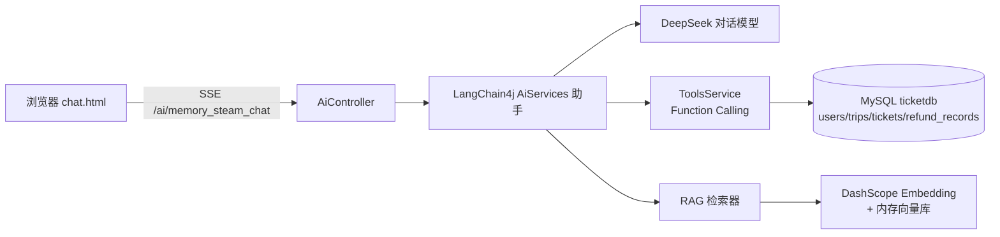

# 智能退票 AI 客服（ZNTP）

> 铁路客票场景的智能客服：多轮对话记忆 + 退票条款 RAG 检索 + Function Calling 直连数据库完成**查票 / 退票**业务操作，回答经 SSE 流式输出到网页。

- 技术栈：`Java 17` · `Spring Boot 3.0` · `LangChain4j` · `DeepSeek`（对话）· `DashScope text-embedding`（向量化）· `MyBatis-Plus` · `MySQL` · `WebFlux Flux`
- 在线演示：见仓库顶部链接（部署中）

## ✨ 核心能力

| 能力 | 实现 |
|------|------|
| 客服角色约束 | `@SystemMessage` 定义「12345 铁路客服」人设，办理业务前必须先收集预订号与客户姓名，退票另需核验注册手机号，自动注入当前日期 |
| Function Calling | `@Tool` 声明 `queryTicketsByUsername` / `processRefund`（带手机号身份核验参数），模型自主决定何时调用，经 MyBatis-Plus 查询/更新**真实 MySQL 数据** |
| RAG 检索增强 | 退票条款文本 → 200 字符滑窗切块 → DashScope 向量化 → `EmbeddingStoreContentRetriever`（maxResults=5, minScore=0.6）；条款加载失败自动降级为纯对话 |
| 多轮记忆 | `@MemoryId` + `chatMemoryProvider`：以浏览器 HttpSession ID 为界，每个访客独立的 10 轮滑动窗口（进程内，重启即清，多访客互不串线）；`FileChatMemoryStore` 提供另一套按 memoryId 分文件的存储实现，当前线上端点未启用 |
| 流式输出 | `TokenStream` → `Flux<String>`（SSE），前端逐字渲染，不等全文 |
| 接口限流 | `AiRateLimitFilter`（滑动窗口）：每 IP 每分钟最多 10 次调用，超出 429；单条消息 >300 字直接 413；兼容反向代理 `X-Forwarded-For`。另在模型层设 `max-tokens=800` 封顶单次输出——公开部署下三重防刷，杜绝大模型 token 被薅 |

## 🧠 架构



启动时 `CommandLineRunner` 自动把 `rag/terms-of-service.txt` 切块向量化灌入内存向量库。

## 🚀 快速开始

```bash
# 1. 初始化演示数据库（含建库建表 + 张三/李四示例数据）
mysql -u root -p < src/main/resources/sql/init.sql

# 2. 注入密钥（PowerShell 示例；密钥不进仓库，绝不硬编码）
$env:DEEPSEEK_API_KEY = "sk-your-deepseek-key"
$env:DASHSCOPE_API_KEY = "sk-your-dashscope-key"
$env:DB_PASSWORD = "your-mysql-password"

# 3. 启动
.\mvnw.cmd spring-boot:run

# 4. 打开内置聊天页
start http://localhost:8080/chat.html
```

## 💬 示例对话

```
用户：我是张三，想退掉我的票
助手：（调用 queryTicketsByUsername("张三") → 查到票 1：北京→上海 ¥500）
      为您查到一张 5 月 1 日北京到上海的票，票号 1。为保护账户安全，请提供注册手机号后四位核验～
用户：我的注册手机号是 13800138001
助手：（调用 processRefund("张三", 1, "13800138001") → 手机号核验通过 → UPDATE tickets/refund_records）
      核验通过，已为您办理退票，退款 500.00 元将于 3-5 个工作日原路退回～
```

## 📁 项目结构

```
ZNTP/
├── src/main/java/com/gec/
│   ├── config/AiConfig.java            # 助手装配：提示词 / Tools / RAG 检索器 / 条款向量化灌库
│   ├── config/AssistantConfig.java     # session 作用域 ChatMemory
│   ├── config/FileChatMemoryStore.java # ChatMemoryStore 文件存储实现（实验性，未接入线上路径）
│   ├── config/AiRateLimitFilter.java   # /ai/** 每 IP 滑动窗口限流（429）
│   ├── controller/AiController.java    # /ai/memory_steam_chat，TokenStream → Flux SSE
│   ├── entity/ + mapper/               # MyBatis-Plus：users / trips / tickets / refund_records
│   ├── service/TicketServiceImpl.java  # 查票、退票业务
│   └── service/ToolsService.java       # @Tool 函数调用入口
├── src/main/resources/
│   ├── application.properties          # 全部密钥走环境变量占位符
│   ├── rag/terms-of-service.txt        # 退票条款（RAG 语料）
│   ├── sql/init.sql                    # 建库脚本 + 演示数据
│   └── static/chat.html                # 极简聊天前端
└── pom.xml                             # Maven（含 wrapper，clone 即可构建）
```

## ⚠️ 说明

- 数据库中的张三/李四及票价为**虚构演示数据**。
- 对话模型与向量模型分属 DeepSeek 与阿里云 DashScope 两家服务，需分别申请 Key。
- 本项目为个人课程作品（软件工程与 UML 实训），代码开源仅供学习交流。
